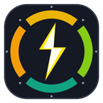

# AI Quota Monitor (Chrome Extension)

<p align="center">
  
</p>

<p align="center">
  <b>ส่วนขยาย Chrome สำหรับตรวจสอบโควตาและอัตราการใช้งาน AI แบบเรียลไทม์</b><br />
  รองรับ <b>Claude.ai</b>, <b>Gemini Pro</b>, <b>MiniMax</b> และ <b>OpenAI Codex</b> พร้อมระบบเตือน Burn-Rate 3 ระดับ และ Chrome Side Panel
</p>

---

## ✨ ฟีเจอร์เด่น (Key Features)

- 🤖 **รองรับ 4 ผู้ให้บริการ AI ชั้นนำ:**
  - **Claude.ai:** เช็คโควตารอบ 5 ชั่วโมง (Rolling 5H) และรอบสัปดาห์ (Weekly Limit) อัตโนมัติจากเซสชันเบราว์เซอร์
  - **Gemini Pro:** รองรับโควตาแยกกลุ่ม Multi-Pool (Flash, Argon, Claude+GPT) ผ่าน Antigravity Local Language Server (Port 63071) หรือ Google Cloud Code OAuth
  - **MiniMax:** รองรับ Coding Plan และ Token Plan ผ่าน MiniMax API Host
  - **OpenAI Codex:** ตรวจสอบโควตา ChatGPT / Codex CLI แบบเรียลไทม์ พร้อมตรวจจับประเภทแพ็กเกจ (Plus / Pro / Team)
- 📊 **7-Day Segmented Weekly Rack:** ซอยแท่นวัดโควตารอบสัปดาห์ออกเป็น 7 ช่องตามวัน (`D1` – `D7`) พร้อมระบุสัญลักษณ์วันปัจจุบัน (`▼`)
- ⚡ **ระบบคำนวณ Burn-Rate เตือน 3 ระดับความวิกฤติ:**
  - **● ปกติ (On Pace):** ปริมาณการใช้อยู่ในเกณฑ์ปลอดภัย พร้อมแนะนำงบเฉลี่ยที่ใช้ได้ต่อวัน
  - **▲ เร่งตัว (High Burn):** เริ่มใช้เกินเป้าของวัน พร้อมคำแนะนำให้ชะลอการใช้งาน
  - **⚡ วิกฤติ (Critical):** เสี่ยงโควตาหมดก่อนครบสัปดาห์ เตือนให้ลดหลั่นการใช้งานทันที
- ⏳ **Real-time Countdown Box:** กล่องนับถอยหลังขนาดใหญ่ แสดงเวลาที่เหลือก่อนโควตารีเซ็ตเมื่อใช้งานครบ 100%
- 📌 **Chrome Side Panel Integration:** ปุ่ม `📌 Sidebar` สำหรับย้ายหน้าจอไปเปิดในแถบด้านข้างของเบราว์เซอร์ ทำงานคู่กับงานอื่นได้สะดวก
- ⚙️ **Custom Provider Toggles:** สลับเปิด/ปิดการแสดงผลของแต่ละโมเดลได้อิสระ หากช่วงไหนไม่ได้สมัครโมเดลใดก็สามารถปิดซ่อนไว้ได้
- 🎨 **Minimal Matte Dark UI:** ธีมสีดำด้านพรีเมียม สบายตา ตัดแสงสะท้อนและลดความลายตา ขยายขนาดฟอนต์ให้อ่านง่ายไม่ต้องเพ่ง

---

## 🚀 วิธีการติดตั้งใช้งาน (Installation Guide)

สามารถติดตั้งใน Google Chrome, Brave, Microsoft Edge หรือเบราว์เซอร์ที่รองรับ Chromium ได้ทันทีโดยไม่ต้องผ่าน Chrome Web Store:

1. **ดาวน์โหลดโค้ด:**
   - กดปุ่ม **`Code`** สีเขียวด้านบน แล้วเลือก **`Download ZIP`** (หรือใช้คำสั่ง `git clone`)
   - แตกไฟล์ ZIP ไปยังโฟลเดอร์ที่คุณต้องการในเครื่อง
2. **เปิดหน้าจัดการส่วนขยาย:**
   - พิมพ์ `chrome://extensions` ในช่องที่อยู่เว็บ (URL) ของ Chrome แล้วกด Enter
3. **เปิดโหมดนักพัฒนา (Developer mode):**
   - เปิดสวิตช์ **`Developer mode` (โหมดนักพัฒนา)** ที่มุมขวาบนของหน้าจอ
4. **โหลดส่วนขยาย:**
   - คลิกปุ่ม **`Load unpacked` (โหลดส่วนขยายที่คลายการบีบอัดแล้ว)** ที่มุมซ้ายบน
   - เลือกโฟลเดอร์ `ai-quota-extension` ที่ดาวน์โหลดไว้
5. **เริ่มใช้งาน:**
   - ไอคอน AI Quota Monitor จะปรากฏบนแถบเครื่องมือของ Chrome
   - คลิกไอคอนเพื่อตรวจสอบโควตา หรือคลิกปุ่ม `📌 Sidebar` เพื่อย้ายไปใช้งานที่แถบด้านข้าง

---

## 🛠️ การตั้งค่าและสิทธิ์การเข้าถึง (Configuration)

เมื่อเปิดส่วนขยายขึ้นมา สามารถกดปุ่ม **`⚙️`** ที่มุมขวาบนเพื่อเข้าสู่หน้าตั้งค่า:

| บริการ AI | วิธีเชื่อมต่อข้อมูล |
| :--- | :--- |
| **Claude.ai** | เพียงล็อกอินเข้าใช้งานบัญชี Claude บนเว็บไซต์ [claude.ai](https://claude.ai) ใน Chrome ส่วนขยายจะดึงโควตาผ่านเซสชันคุกกี้อัตโนมัติ |
| **Gemini Pro** | หากเปิด **Antigravity IDE** อยู่ ระบบจะดึงข้อมูลผ่าน Local Port `63071` อัตโนมัติ หรือใส่ Refresh Token ของ Google Cloud Code ในช่องตั้งค่า |
| **MiniMax** | กรอก **MiniMax API Key** (`sk-cp-...` หรือ `sk-sp-...`) และ Group ID (ทางเลือก) จาก MiniMax Platform |
| **OpenAI Codex** | เพียงล็อกอินเข้าใช้งาน [chatgpt.com](https://chatgpt.com) ในเบราว์เซอร์ ระบบจะตรวจจับโควตา Codex อัตโนมัติ (หรือใส่ Codex Access Token ในหน้าตั้งค่า) |

---

## 📁 โครงสร้างโปรเจกต์ (Project Structure)

```text
ai-quota-extension/
├── manifest.json       # ไฟล์ตั้งค่าส่วนขยาย (Manifest V3)
├── background.js       # Service worker ดึงข้อมูลโควตาและคำนวณรอบรีเซ็ต
├── popup.html          # โครงสร้างหน้าต่าง UI (Popup & Side Panel)
├── popup.css           # สไตล์ Minimal Dark UI & การแบ่งแท่ง 7 ช่อง
├── popup.js            # ควบคุมการแสดงผล, ตัวนับถอยหลัง และคำนวณ Burn Rate
├── generate_icons.py   # สคริปต์ Python สำหรับสร้างไอคอนขนาดต่างๆ
├── icon-16.png         # ไอคอนขนาด 16x16 px
├── icon-32.png         # ไอคอนขนาด 32x32 px
├── icon-48.png         # ไอคอนขนาด 48x48 px
├── icon-128.png        # ไอคอนขนาด 128x128 px
├── favicon.png         # Favicon สำหรับหน้าแท็บ
├── favicon.ico         # ไอคอน Favicon มาตรฐาน
├── LICENSE             # ใบอนุญาต MIT License
└── README.md           # คู่มือและเอกสารการใช้งาน
```

---

## 📄 ใบอนุญาต (License)

โปรเจกต์นี้เผยแพร่ภายใต้ใบอนุญาต [MIT License](LICENSE) สามารถนำไปใช้งาน ปรับปรุง พัฒนาต่อยอด หรือแจกจ่ายได้อย่างอิสระ
